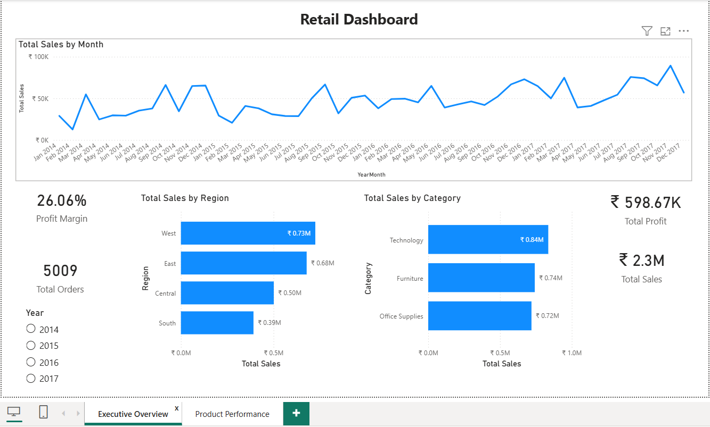

# Retail Business Analytics

An end-to-end retail business analytics project using **Excel, MySQL, and Power BI** to analyse sales performance, product profitability, customer segments, and regional trends.

## Project Overview

This project analyses retail sales data to identify business trends, evaluate profitability, and generate actionable insights to support data-driven decision-making.

## Tools & Technologies

- **Excel:** Data cleaning, inspection and preparation
- **MySQL:** Data validation, and business analysis
- **Power BI:** Interactive dashboards and visualisation

## Project Workflow

### 1. Data Preparation — Excel
- Inspected the raw retail dataset and cleaned it.
- Checked for missing values and duplicate records.
- Prepared the dataset for database analysis.

### 2. Data Cleaning & Analysis — MySQL
- Created the `retail_analytics` database and imported the dataset.
- Cleaned sales, profit, and discount fields.
- Validated record counts and key business metrics.
- Performed 11 business analysis queries covering:
- Top-performing products
- Monthly sales and profit trends
- Regional sales performance
- Customer segment profitability
- Year-over-year sales growth
- Discount impact on profitability
- Product-level profitability

### 3. Dashboard Development — Power BI
- Connected Power BI to the MySQL database.
- Built an interactive dashboard with two pages:
- Executive Overview
- Product Performance
- Added KPI cards, trend charts, product rankings, and regional/category comparisons.
- Implemented synced Year slicers for interactive analysis.

## Key Business Insights

1. **Profitability Trend:** 2017 recorded the highest profit margin across the analysed years.
2. **Regional Performance:** The West region was generally the strongest sales contributor, while the South region frequently recorded the lowest sales.
3. **Category Performance:** Technology was the leading revenue-generating category in most years, with a different leading category in 2015.
4. **Sub-category Profitability:** Binders emerged as the highest profit-generating sub-category.
5. **Product Profitability:** High sales do not always translate into high profits. Cisco TelePresence EX90 generated approximately ₹22.6K in sales with an 8% profit margin, while HON 5400 Series Task Chairs achieved a 10.26% margin.

## Business Recommendations

1. **Regional Strategy:** Investigate the products driving sales in the West and maintain adequate inventory. Examine demand and stock levels in the South to reduce potential overstocking.
2. **Technology Products:** Prioritise high-demand Technology products with healthy profit margins and maintain sufficient inventory.
3. **Binders:** Maintain adequate inventory of Binders and explore targeted promotions to strengthen sales.
4. **Product Profitability:** Evaluate product margins alongside revenue when making pricing, discounting, and inventory decisions.
5. **Profitability Improvement:** Analyse the factors behind the strong 2017 profit margin and apply successful strategies to improve future performance.

## Power BI Dashboard

### Executive Overview

### Product Performance

